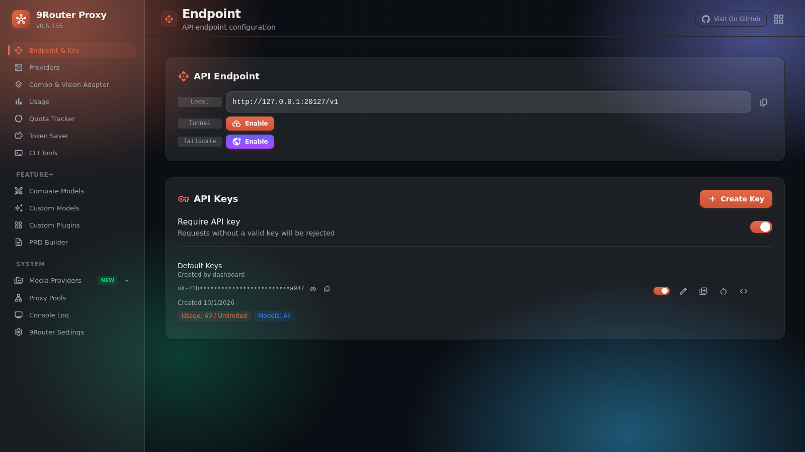

<div align="center">


**Aries Router** is a production-hardened fork of [Decolua/9router](https://github.com/Decolua/9router) — a unified AI gateway that exposes a single OpenAI-compatible endpoint and routes to Claude, GPT, Gemini, Kimi, Qwen, GLM, DeepSeek, Grok, Antigravity and 40+ more upstream providers, using OAuth accounts, direct API keys, web sessions, or your own self-hosted engines.

[](./LICENSE) [](https://github.com/Decolua/9router) [](./CHANGELOG.md) [](https://nodejs.org)

</div>

---

## Screenshots

<div align="center">



</div>

## What Is Aries Router?

Aries Router sits between your AI clients and every model provider you use. Clients speak one standard wire format; the router handles authentication, translation, account rotation, quota tracking, failover and streaming — so a single base URL and a single API key give access to the whole fleet.

- **Accepts** — OpenAI Chat Completions (`/v1/chat/completions`), Anthropic Messages (`/v1/messages`), Gemini native (`/v1beta/models/{model}:generateContent`), Codex/Responses (`/responses`).
- **Routes to** — official OAuth accounts (Claude Console, Antigravity/Gemini, Grok, Kiro, Qwen, …), direct API keys (OpenAI, DeepSeek, Upstage, …), community free gateways (100milionseek, Capinzo, TokenJuice, ArxPay, …), and local engines (Ollama, vLLM, LM Studio) via custom OpenAI-compatible nodes.
- **Returns** — normalized, streaming-first responses with usage accounting, regardless of what the upstream speaks.

## Connection Tiers

| Tier | Description |
| --- | --- |
| **OAuth & Device Auth** | Official account sessions with automatic token refresh and tier detection (e.g. Antigravity free/pro/ultra tiers). |
| **Direct API Keys** | Standard key-based integration for commercial providers. |
| **Free Tier Relay** | Zero-configuration routing through free developer and community gateways. |
| **Web Cookie Sessions** | Structured dual-column adapters for consumer web platforms (Gemini `1PSID/1PSIDTS`, Grok `sso/sso-rw`) with smart auto-split parsing. |
| **Local & Self-Hosted** | Any OpenAI-compatible endpoint as a custom provider node. |

## Core Features

### Multi-Account Ring & Failover Engine
- Round-robin and fill-first account rotation with per-account health tracking.
- Auto-lock: failing accounts are temporarily locked per model (exponential backoff) instead of being hammered.
- Auto-prune: permanently dead credentials (401/403/402) are evicted from the active pool with zero downtime.
- Transparent format translation between OpenAI, Claude and Gemini wire formats — including tool calls and thinking/reasoning blocks.

### Antigravity Integration (deep fork feature)
- Full OAuth onboarding with `loadCodeAssist` / `onboardUser` polling and project provisioning.
- Per-account **live model catalog** (`v1internal:fetchAvailableModels`) — a Pro or Ultra account automatically exposes the models its plan actually allows, with disabled models filtered out.
- Canonical **IDE identity rewrite (v2.32.1)** applied only to generation endpoints, so onboarding endpoints pass through untouched (no Google protobuf metadata errors).
- **429 engine**: classification of `RESOURCE_EXHAUSTED` responses with per-error retry-after scheduling, plus live per-account quota aggregation (session 5h / weekly buckets, per-model and per-family summaries).
- Optional **ACP transport**: drive the operator's own `agy` CLI so requests carry the CLI's account, quota and client fingerprint.

### Proxy & Network Layer
- Built-in **proxy harvester** with configurable scan budget (50–50,000 candidates) and 24 built-in verified public feeds, plus custom feed support.
- Pool management with per-provider disjoint slices, health probing, TCP pre-checks and a sliding worker pool that eliminates head-of-line blocking.
- Dashboard controls: **Sync Proxy Pool** and **Rotate WARP** actions via the pv-sync API.
- Per-connection egress through configured residential/datacenter pools.

### Enterprise Controls
- Virtual client API keys with per-key model whitelists (dual-column synced), RPM/TPM rate limits, token budgets and quota progress bars (emerald / amber / pulsing red / infinite neon).
- IP allowlisting, budget caps, and automated state backups.
- Usage analytics with per-key, per-model and per-account breakdowns; quota tiers surfaced live.

### Model Bypass & Prompt Injection Studio
- Rule-based **model bypass**: match on model, key, or user text and rewrite/reroute requests (variables interpolated, positions selectable, dry-run simulation built in).
- **Prompt injection** rules with ordering, variables and a test simulator before going live.

### Combos & Model Editor
- **Combos**: fallback chains, round-robin groups, and fusion strategies over any set of models — selectable by name from any client.
- **Model editor**: alias upstream models, override names, thinking levels, and pricing.

### Media & Beyond-Text Endpoints
- Text-to-Image, Image-to-Text, Video Generation, TTS, STT, Embeddings and Web Search/Fetch endpoints are exposed natively through the same gateway.

### Remote Ops
- **Telegram bot remote control** for status, keys and administration.
- MITM tooling for CLI clients (Claude Code, Antigravity IDE, …) with certificate management.
- Security audit trail: sign-ins, lockouts, and automatic fingerprinting of malicious probes (SQLi, XSS, path traversal).
- Settings history with before-image snapshots and 1-click rollback.

## Architecture & Design

- **Runtime**: Node.js 22+ (ESM) with an embedded Next.js 14 App-Router dashboard (standalone output).
- **Storage**: SQLite in WAL mode via `node:sqlite` (with `better-sqlite3` fallback), tuned pragmas (busy_timeout, mmap, WAL checkpoints).
- **Zero native build requirements** for the default path — no CGO, no node-gyp on the common setup.
- **Protocol adapter**: one ingestion layer translates OpenAI / Anthropic / Gemini schemas on the fly and streams normalized output back.
- **SSE-first**: streaming is the default path for chat; non-streaming clients get transparent aggregation.

## Getting Started

```bash
git clone https://github.com/hardianto77/aries-router.git
cd aries-router
npm install
npm run dev          # dashboard on http://localhost:20128
```

Production:

```bash
npm run build
npm run start
```

Docker:

```bash
docker build -t aries-router .
docker run -d -p 20128:20128 -v aries-data:/app/data aries-router
```

Configuration lives in `.env` (see [.env.example](./.env.example)). Required: `JWT_SECRET`, `INITIAL_PASSWORD`, `DATA_DIR`. Recommended: `PORT`, `API_KEY_SECRET`, `MACHINE_ID_SALT`, `BASE_URL`. State (SQLite database, backups, secrets) lives in `DATA_DIR`.

Once it is running:

| | |
| --- | --- |
| Dashboard | `http://localhost:20128/dashboard` (first login: value of `INITIAL_PASSWORD`) |
| OpenAI-compatible | `http://localhost:20128/v1` |
| Claude-compatible | `http://localhost:20128/v1/messages` |
| Gemini-native | `http://localhost:20128/v1beta/models/{model}:generateContent` |
| Codex / Responses | `http://localhost:20128/responses` |
| Health probe | `GET /api/health` |

Point any CLI tool or agent at the base URL, generate a virtual key under **Endpoint & Key**, and you are done.

## Model Names You Can Call

| Form | Example |
| --- | --- |
| Provider model | `kiro/claude-sonnet-4.5`, `kimi/kimi-k2.6`, `deepseek/deepseek-v4.1-pro` |
| Antigravity model | `ag/gemini-3.8-flash`, `ag/claude-sonnet-4-6`, `ag/gpt-oss-120b-medium` |
| Custom node | `mynode/gpt-oss-120b` |
| Combo | `my-combo` (fallback, round-robin, fusion and more) |
| Custom model | any name you define in Custom Models |

## Fork Differences From Upstream

This fork tracks upstream closely but carries production fixes and features that upstream does not have. Recent highlights (see [CHANGELOG.md](./CHANGELOG.md) for the full history):

- Antigravity: live per-account catalogs, IDE v2.32.1 identity rewrite, 429 engine, quota family aggregation, ACP transport, upstream merge from [johsua092-ui/xrouter](https://github.com/johsua092-ui/xrouter).
- API keys: whitelist correctly persisted on creation (dual-column `accessRestricted`/`accessAllow` sync fix).
- Proxy harvester: freeze/deadlock fixes, custom feeds, configurable scan limits, `seren-` pool naming.
- Stability: SQLite `busy_timeout` raised to 15s to absorb usage-stat write contention; standalone build chunk patches for the agy CLI executor.

## Credits

- Built on **[Decolua/9router](https://github.com/Decolua/9router)** — full credit to upstream for the router core, providers and translators.
- Antigravity upstream work merged from **[johsua092-ui/xrouter](https://github.com/johsua092-ui/xrouter)** (MIT).
- License: **MIT**, same as upstream. See [LICENSE](./LICENSE).

---

<div align="center">

If this project helped you, a star is appreciated.

[](https://github.com/hardianto77/aries-router)

</div>


